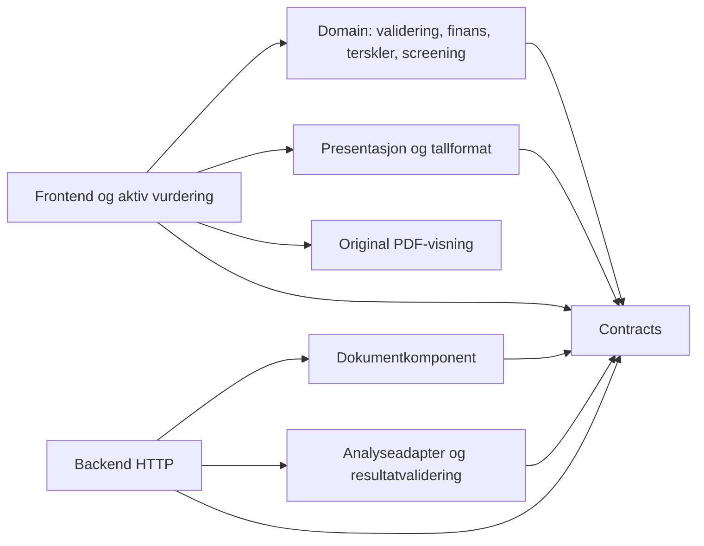
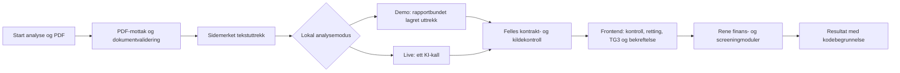

# Architecture Spine — Property Acquisition Agent

## Design Paradigm

**Functional core / imperative shell:** rene TypeScript-moduler eier validering, årsnormalisering, finans og screening; React eier aktiv økt og UX; en liten Express-backend eier PDF- og KI-I/O. Hele v1 leveres som én lokal webapp med sekvensiell pipeline.

PRD og DESIGN/EXPERIENCE er bindende. `[ADOPTED]` markerer regler arvet fra disse kildene eller eksplisitte brukervalg Q-1–Q-7 i [beslutningsloggen](.memlog.md). Arkitekturen oppretter ingen epics, stories, kode eller produktbevis.

## Invariants & Rules

### AD-1 — Modulgrenser og importretning [ADOPTED]

- **Binds:** Hele v1; UJ-1; FR-1–FR-18.
- **Prevents:** Finans-/anbefalingslogikk i React, Express eller KI og konkurrerende eiere av vurderingen.
- **Rule:** `domain` og `contracts` har ingen React-, Express-, PDF-, fil-, nettverks- eller miljøavhengighet. `domain` eier rene funksjoner for inputvalidering/årsnormalisering, finans, terskler og screening. `frontend` bruker kjernen; `backend` bruker dokument- og analysekomponenter og gir aldri finansresultat eller anbefaling. Presentasjon formaterer resultater og er ikke input til reglene. Begge sider importerer samme `contracts`; ingen kopierte DTO-er eller regelimplementasjoner.

Pilene viser tillatt importretning:



### AD-2 — Frontend eier aktiv økt og opphav [ADOPTED]

- **Binds:** FR-4–FR-6, FR-8–FR-11, FR-15, FR-18; UX kontroll-/endringsflyt.
- **Prevents:** Overskrevet KI-opprinnelse, utkast som screeninggrunnlag og gamle bekreftelser/resultater brukt på nye data.
- **Rule:** Én frontend-tilstand overlever navigasjon mellom de fire trinnene. Den holder tallgrunnlag, original-PDF, immutabelt opprinnelig uttrekk, kontrollhandlinger, korrigeringsutkast, gjeldende liste, separat TG3-avklaring og siste resultatsnapshot. Utkast brukes først ved **Bruk korrigering**; **Avbryt** bevarer gjeldende versjon. Brukt korrigering/avvisning bevarer originalen og krever ny listebekreftelse; Bruk korrigering opphever også enkeltfunnets bekreftelse. Resultat opplyser om et ubrukt korrigeringsutkast uten å bruke det som screeninggrunnlag. Finansbekreftelse gjelder den kontrollerte verdien med periode/år/kilde/kostnadsgrunnlag; faktisk endring opphever berørt bekreftelse. TG3-endring gjør resultatet utdatert og reevalueres etter FR-5 uten ny bekreftelse av uendrede tall/liste. TG3-avklaringen er bundet til det faktiske rapportforholdet og grunnlaget den ble registrert mot; findingId alene tillater ikke overføring til et annet teknisk forhold ved korrigering. Retting av representasjon/kilde for samme forhold kan bevare avklaringen. Kjent motstrid eller ukjent tilhørighet mellom gammel avklaring og gjeldende forhold holdes synlig som utilstrekkelig grunnlag etter FR-5/FR-9/FR-11, uten ny UX-handling. Navigasjon alene endrer ingen grunnlagsrevisjon. Siste resultat binder finans-, liste-, TG3- og rapportrevisjon; ved avvik vises det bare historisk med **Utdatert** og konkret oppdateringsbehov. Sideoppdatering/lukking avslutter økten; ingen lokal database eller varig vurderingslagring.

### AD-3 — Sidemerket dokumentgrunnlag og originalkilde [ADOPTED]

- **Binds:** FR-6–FR-9; S2/S4; UX PDF-kontroll.
- **Prevents:** Tap av sider, OCR som skjult utvidelse og tekstuttrekk brukt som erstatning for originalen.
- **Rule:** Backend dokumentkomponent tar én PDF, validerer format og høyst 30 sider og returnerer eksplisitt `pages` med én post per PDF-posisjon `1..pageCount`, tekst og uttrekksstatus. Rapportinnhold uten brukbart tekstlag eller med kjent upålitelig/ufullstendig lesing gir dokumentfeil; feil blir ikke vellykket tomtekst. [R2-regelen](../../r2-pdf-lesbarhet-semester-v1.md) skiller readable fra deterministisk bevist blank (gyldig, blokkerer ikke alene); unreadable/unknown/incomplete blokkerer completed med alle berørte fysiske sider. Bare bevist fravær av innhold gir blank; tvil gir unknown. Tekstløse foto-/bildesider kan avvises konservativt. En helt blank PDF er ingen støttet tekstbasert rapport. Ingen OCR, vision, manuell semantisk klassifisering av tekstløse sider eller vilkårlig tegn-/prosentterskel. Ingen skjult bortfiltrering av sider/funn. Alle sider sendes samlet til analyseadapteren i ett live-kall. Originalbytes beholdes separat i frontend for innebygd visning, automatisk PDF-side ved funnvalg, hel side og nabosider. Filposisjon fra 1 er autoritativ; trykt sidetall er bare merket tillegg. Tabell-/kolonne-/lesbarhetsrisiko kontrolleres mot original og rapportfasit; antall sider eller gyldig JSON beviser ikke riktig TG-uttrekk.

### AD-4 — Én delt, validert kontrakt og eksplisitt fullføring

- **Binds:** Backend, frontend, dokumentkomponent, adaptere og fixtures; FR-6–FR-11, FR-16–FR-18.
- **Prevents:** Ulike svarformer, transportfeil som tomliste og strukturell validering forvekslet med kildebekreftelse.
- **Rule:** `contracts` eier runtime-skjema og avledede TypeScript-typer. Minste API-kontrakt har skjemaversjon, `requestId`, `reportHash`, modus og diskriminert `completed`/`failed`. Fullført svar inneholder sideantall, funn og eksplisitte usikkerheter/mangler. Feil har `document` eller `analysis`, stabil kode, berørt dokument/side/funn når kjent og trygg årsakstekst. Gyldig tomliste er kun `completed` med `findings: []`; manglende svar/felt er feil. Uklar grad/kilde/side bevares som usikker kandidat med originalt opphav, ikke gjettet gyldig TG-funn. Sidekontroll knytter kilder til aktuell rapport og markerer ugyldig/manglende støtte. Backend beregner rapporthash fra mottatte originalbytes og setter dokument-/korrelasjonsmetadata i kode; KI får ikke velge denne identiteten. Backend validerer adapterens terminalstatus, struktur og kildehenvisninger; frontend validerer API-svaret og identiteten igjen. Dette bekrefter ikke semantisk fullstendighet eller brukerens kontroll. Uløste kritiske usikkerheter og ufullstendig analyse er fortsatt prioritet 1; manuell bekreftelse kan ikke oppheve dokument-/analysefeil.

### AD-5 — Ett HTTP-forløp med vern mot duplikater og gamle svar [ADOPTED]

- **Binds:** FR-6, FR-9, FR-18; NFR-1/NFR-5; Q-7.
- **Prevents:** Doble KI-kall, gamle svar som nytt grunnlag og avbrudd fremstilt som fullføring.
- **Rule:** Eksplisitt **Start analyse** sender ett `POST /api/analysis` med PDF og korrelasjonsidentitet; frontend går til **Analyserer** og sperrer dobbeltstart for samme pågående analyse. Backend gjør dokumentsteg, adaptervalg og resultatvalidering før terminalt svar. Frontend aksepterer kun et validert svar som matcher aktiv økt, rapporthash, forespørsel og analysegenerasjon. Å forlate analyseforløpet eller erstatte rapporten ugyldiggjør generasjonen; vanlig retur til tidligere trinn etter fullføring følger AD-2. Et sent svar kan ikke gjøre forlatt/erstattet analyse gjeldende. AbortController er best effort. Backend har en prosesslokal duplikatsperre nøstet på aktiv økt, lokal modus og backendberegnet rapporthash; ny requestId eller analysegenerasjon omgår ikke sperren. Markøren settes før adapterkall og beholdes til serverstopp, også når klientforbindelsen forsvinner; duplikater gir en tydelig feil uten nytt adapterkall. Dette er kun teknisk metadata, ingen vurderings-/jobbtilstand eller gjenopptakbart jobb-API. Ingen automatisk retry i frontend, backend eller senere SDK-konfigurasjon, ingen jobb-ID/statuspolling eller persistent jobbtilstand. Timeout/transportfeil er synlig analysefeil; HTTP 200 alene er ikke fullføring. S5 stopper først når den ferdige validerte listen er synlig, ikke ved avsluttet modellkall.

R3 er [lukket 2026-10-20](../../r3-http-ressurser-semester-v1.md): vedtatte
upload-/bodygrenser, én aktiv request per session/flyt, lokal PDF-/demo-frist
og in-memory cleanup konkretiserer AD-5/AD-9. Cleanup frigjør requestens
PDF-/tekstressurser, men beholder den innholdsløse duplikatmarkøren til
serverstopp. Live-AI-timeout forblir R1; S5 er fortsatt et evalueringsmål.
Håndhevelse og HTTP-testbevis leveres i Story 2.5.

### AD-6 — Felles demo/live-adapter og entydig rapportbinding [ADOPTED]

- **Binds:** FR-6/FR-15–FR-18; NFR-3/NFR-4; S6; Q-4.
- **Prevents:** Egne demoregler, feil rapport/uttrekk-par og skjulte betalte fallback-kall.
- **Rule:** Demo og live bruker samme PDF-mottak, dokumentvalidering og sidemerkede uttrekk før en smal adaptergrense. Adapterinput er det versjonerte sidemerkede dokumentgrunnlaget; retur og feil følger AD-4. Demo slår opp lagret, strukturert uttrekk med samsvarende SHA-256 av PDF-bytes og kontrakt-/uttrekksversjon. Feil/manglende fixture gir analysefeil, aldri live-fallback. Backend velger modus fra eksplisitt lokal konfigurasjon; demo er standard og oppretter ingen KI-klient. UI viser **Demo · lagret KI-uttrekk** eller **Live analyse** gjennom hele flyten. Kontroll, korrigering, TG3, finans og screening er identiske etter retur. Uendret rapportuttrekk gjenbrukes i aktiv økt; finans-/funn-/TG3-endringer gjør ingen KI-kall. Ny rapport ugyldiggjør tidligere rapportgrunnlag og krever ny analyse/kontroll. Testadaptere kan injiseres ved samme grense. Demo dokumenterer systemflyt/kjørbarhet, ikke live KI-kvalitet eller live-tid.



### AD-7 — Eksakte finansgrenser og separat presentasjon [ADOPTED]

- **Binds:** FR-1–FR-4, FR-12–FR-15; S1/S3/S4; Q-5.
- **Prevents:** Flyttallsfeil, blandede årsperioder, skjulte nuller og visningsavrunding brukt i screening.
- **Rule:** Beløp/prosent ved modulgrenser er kanoniske desimalstrenger; manglende verdi er en egen tilstand, aldri `"0"`. Ingen Number/parseFloat-konvertering før nøyaktig desimalaritmetikk. Validering/normalisering holder registrert verdi, kilde/forutsetning, kostnadsinnhold, periode/år, faktor og anvendt årsverdi sammen. P er totalpris inklusive eventuell fellesgjeld, uten kjøpsomkostninger; D er eierbetalt drift, mens renter/avdrag inklusive fellesgjeld inngår i J og telles aldri også i D. Inkluderte kostnadsposter holdes atskilt uten dobbelttelling; ingen ekstra fratrekk legges til formlene. P>0; L/D/J/Ymin>=0; null krever eksplisitt bekreftelse; konflikter/ubekreftede verdier er utilstrekkelige. Bare kjent måned omregnes med 12, og L/D/J må gjelde samme år. Finans bruker L-D for NOI og L-D-J for kontantstrøm; brutto-/nettoyield beholder L/P og NOI/P som formelgrunnlag til presentasjon. Hvert nøkkeltall har eget gyldighetsgrunnlag; manglende P hindrer yield, ikke gyldig NOI/kontantstrøm. Negative kodeberegnede resultater beholdes. `thresholds` bruker med gyldig P eksakt `100 * NOI >= P * Ymin` og kontantstrøm `>= 0`; likhet godtas uten toleransemargin. Divisjon/avrunding til yieldvisning skjer i presentasjonslaget med biblioteket og går aldri tilbake til reglene. Ingen egen heltalls-/brøkaritmetikk. Validering, finans, terskler, screening og formatering er separate testbare funksjoner.

### AD-8 — Én kodebasert screening og separat TG3-avklaring [ADOPTED]

- **Binds:** FR-5, FR-13, FR-16–FR-18; NFR-1; S3/S4.
- **Prevents:** KI-anbefalinger, økonomi som overstyrer mangler og listebekreftelse som teknisk avklaring.
- **Rule:** `screening` tar ett gjeldende grunnlag med finansgyldighet, rapport-/kontrollstatus og separat brukerregistrert TG3-status. Felles inputvalidering eier avklaringens anvendbarhet til gjeldende rapportforhold; state/UI og screening gjør ingen konkurrerende lokale tolkninger. Det er en kontroll av registrert binding og kjent motstrid, ikke automatisk semantisk klassifisering eller ekstern verifisering. Screening kan ikke bruke en avklaring med uavklart anvendbarhet som gyldig Avklart. Den returnerer én anbefaling, avgjørende prioritet, alle utløsere på dette nivået, kodebegrunnelse og anbefalingsbundet neste handling. Fast rekkefølge: kritiske mangler/konflikter/feil/ubekreftelser eller uavklart alvorlig TG3 → **Innhent mer informasjon**; ellers yieldbrudd eller negativ kontantstrøm → **Forkast**; ellers → **Gå videre**. Å kunne beregne tall er ikke tilstrekkelig screeninggrunnlag. Samme grunnlag gir identisk, stabilt ordnet regelresultat og tekst; ingen KI-generering/omskriving. TG3-avklaring følger FR-5: eksplisitt Avklart og begge ikke-tomme tekster kreves; ukjent/ugyldig er uavklart. Rapportgrad/funn beholdes og avklaringen merkes brukerbekreftet, uten ekstern verifisering. Uttrekkskontroll, listebekreftelse og TG3-avklaring er separate. Ingen ny teknisk klassifisering, score eller investeringsbeslutning.

### AD-9 — Lokal levering, konfigurasjon og godkjent UX [ADOPTED]

- **Binds:** NFR-2–NFR-4; S6; DESIGN/EXPERIENCE; Q-6.
- **Prevents:** Demo som krever nett/nøkkel, nøkkel i frontend og arkitektur som endrer valgt UX.
- **Rule:** Sensor/demo bygger frontend med Vite og starter én Express-prosess på loopback som tilbyr bygget frontend og `/api` på samme origin. Alle nødvendige demo-/PDF-/worker-/fontressurser leveres lokalt; worker matcher PDF-bibliotekversjonen. Backend bruker PDF.js legacy-build for Node-uttrekk; frontend bruker browser-build med lokalt bundlet worker. Samme distribusjonsversjon betyr ikke samme build/initialisering. Backend leser lokal live-konfigurasjon og holder nøkkel/leverandørkall utenfor frontend, Git, feilmeldinger og logger. Bare trygg modusmetadata kan gis ved oppstart. Private PDF-er og midlertidig tekst/output versjoneres ikke; mottak behandler bytes uten å bruke filnavn som serversti og rydder midlertidige ressurser. Statisk server tilbyr frontend/demoressurser, ikke reporoten eller private dokumenter. Utviklingsmodus samler Vite/Express bak én kommando. UX bruker de fire fastsatte trinnene, synlig stepper/status, lokale feil med kodeutfall, valgt grafitt/petrol og progressive disclosure. Originalvisning følger side-ved-side fra 1200 CSS px, ellers behovsåpnet PDF-panel med fokus/retur/kontekst/utkast bevart. Tastatur, synlig fokus og statuskunngjøringer følger EXPERIENCE. README og ren lokal kjørbarhet skal verifiseres ved implementering.

### AD-10 — Verifikasjonsgrenser og kravspor

- **Binds:** FR-1–FR-18; NFR-1–NFR-5; S1–S6; senere implementeringsplan.
- **Prevents:** Demo/enhetstester brukt som live-bevis og moduler bygget uten spor til godkjente krav.
- **Rule:** Offline tester bruker faktiske rene moduler og samme dokument-/adapter-/kontraktgrenser som appen. Finans-/regel-/tilstandstester bruker forhåndsdefinert uavhengig fasit; dokumenttester bruker PDF-fixtures med fasit for sider/tekst/TG-funn. E2E kjører den bygde lokale appen med kontrollert adapter, aldri betalt API. Opprinnelig live KI-uttrekk evalueres separat mot alle TG3 og alle TG2 i fasiten etter S2, før brukerretting; kjøringer og tid skilles fra demo. S5 bruker PRDs t_start/t_liste/t_bekreftet; det innføres ingen ny timerfunksjon. Senere stories/kode/testbevis må referere krav-ID, relevante AD-ID-er og testeksempel-ID fra PRD-addendum. Ingen tester eller evalueringer påstås levert av dette dokumentet.

## Consistency Conventions

| Område | Felles konvensjon |
| --- | --- |
| Rapport og korrelasjon | `reportHash`: SHA-256 av originale filbytes, ikke filnavn. `requestId`: unik HTTP-korrelasjon i aktiv økt; ingen jobb-ID. Ny analysegenerasjon ved forlatt/erstattet analyse. Identitet kontrolleres også etter abort. |
| Versjoner | Kontraktversjon og uttrekksformatversjon følger dokumentgrunnlag, adapterretur og demo-fixture; uforenlig versjon gir eksplisitt feil. Skjema er én autoritet i `contracts`. |
| Funn og kilde | Stabil `findingId` innen rapportuttrekket binder original, korrigeringsutkast og brukt endring. TG3-avklaring har i tillegg felles referanse til rapportforholdet/grunnlaget den gjelder; type/validering eies av contracts/domain validation, og samme ID betyr ikke automatisk samme avklaringsgrunnlag. `pdfPage` er heltall fra 1 eller eksplisitt ukjent hos usikker kandidat; aldri gjettet side. Dokumentnavn vises sammen med hashbundet kilde. |
| Resultater og feil | Tilgjengelig nøkkeltall og ikke-beregnbart med årsaker er forskjellige kontrakttilstander. Feil/mangler har stabil kode og mål (felt/funn/dokument/side); kjent og ukjent årsak skilles. Backend-feil er aldri en screeninganbefaling. |
| Finans og tekst | Money/percent er desimalstrenger i NOK/prosent med eksplisitt periode/år. Norsk visning: hele NOK og tre yielddesimaler, mer detaljpresisjon ved behov etter UX. Kodebegrunnelser og neste handling bruker faste tekster knyttet til stabilt ordnede utløsere. |
| Tilstandsmutasjon | Én frontend reducer eier gjeldende økt; rene overganger skiller navigasjon, redigeringsutkast, bruk, avvisning og bekreftelse. Domene-/API-resultater er data; de setter ikke bekreftelser automatisk. |

## Stack

Startstakk kontrollert 2026-10-14; [versjons-/fit-grunnlag](.working/teknologigrunnlag.md). Dette er pins for første implementering, ikke et allerede installert avhengighetstre. Kode og låsfil eier senere kompatibilitet.

| Name | Version |
| --- | --- |
| Node.js | 24.21.0 LTS |
| React / react-dom | 19.3.0 |
| TypeScript | 6.0.2 |
| Vite | 8.3.4 |
| @vitejs/plugin-react | 6.1.2 |
| Oxlint | 1.87.0 |
| Express | 5.3.0 |
| PDF.js / pdfjs-dist | 6.4.299 |
| big.js | 7.0.1 |
| Zod | 4.6.7 |
| Vitest | 5.0.4 |
| Playwright | 1.64.0 |

## Structural Seed

Offisiell Vite `react-ts`-starter, én package.json og package-lock.json, npm fra Node-installasjonen. Vanlig CSS etter DESIGN-tokens og React reducer/context; startstrukturen er ikke en filinventarliste som må vedlikeholdes etter at kode finnes.

```text
src/
  contracts/                 # runtime-skjema og delte typer/identiteter
  domain/
    validation.ts            # feltgrunnlag, årsnormalisering og gyldighet
    finance.ts               # eksakt NOI/kontantstrøm og yieldgrunnlag
    thresholds.ts            # eksakte økonomiske sammenligninger
    screening.ts             # prioritet, alle utløsere og kodebegrunnelse
  frontend/
    state/                   # aktiv økt, revisjoner, bekreftelser og utkast
    screens/                 # de fire godkjente UX-trinnene
    pdf/                     # originalvisning, kilde-side, panel og fokus
    presentation/            # visningsdivisjon, avrunding og norsk format
  backend/
    http/                    # enkelt analyseforløp, feil og duplikatsperre
    documents/               # PDF-validering og sidemerket tekstuttrekk
    analysis/                # demo/live-adapter og resultatvalidering
tests/
  unit/                      # rene moduler og tilstandsoverganger
  integration/               # PDF, HTTP, adaptere og kontrakter
  e2e/                       # bygget lokal app med kontrollert adapter
  fixtures/property-cases/   # fiktive PDF-er, uttrekk og uavhengig fasit
.docs/implementation-artifacts/ # senere faktiske test-/evalueringsbevis
```

Sensor/demo: nettleser → én lokal Express-prosess → statiske frontendressurser eller dokumentpipeline. Bare en eksplisitt konfigurert live-adapter kontakter ekstern KI-leverandør. PDF/tekst/duplikatsperre er midlertidig prosessdata; frontend er vurderingens eier. Ingen database, kontoer, jobbkø eller ekstern driftstjeneste i v1.

Planlagte kommandokontrakter ved implementering: `npm ci` → `npm run build` → `npm run demo`; `npm run dev` for utvikling; `npm test` for lokale modul-/integrasjonstester og `npm run test:e2e` for bygget app. Browserinstallasjon er et dokumentert forberedelsessteg. README skal angi faktisk loopback-adresse og valgfrie live-miljøvariabler. Disse kommandoene eksisterer ikke som app-scripts ennå.

## Capability → Architecture Map

| Krav / område | Modulansvar | Styrende beslutning |
| --- | --- | --- |
| UJ-1, FR-1–FR-4 | Tallgrunnlag, frontend state, domain/validation | AD-1, AD-2, AD-7 |
| FR-5 | Separat TG3-avklaring i state, domain/screening | AD-2, AD-8 |
| FR-6–FR-7 | Backend documents/analysis, frontend analyseforløp | AD-3–AD-6 |
| FR-8–FR-9 | Originalvisning, kilde-/usikkerhetsvalidering, feil | AD-3–AD-5, AD-9 |
| FR-10–FR-11 | Original/utkast/brukerendring og listebekreftelse | AD-2, AD-4, AD-8 |
| FR-12–FR-14 | Domain validation/finance/thresholds, presentation | AD-7 |
| FR-15 | Revisjoner, ny bekreftelse, lokal ny beregning | AD-2, AD-6–AD-7 |
| FR-16–FR-18 | Domain/screening, resultatvisning og historisk snapshot | AD-2, AD-7–AD-9 |
| NFR-1 | Rene regler, overgangslogikk, feil-/racevern | AD-1–AD-2, AD-4–AD-5, AD-8 |
| NFR-2 | Screens, originalvisning, fokus/status/panel, UX-tokens | AD-2, AD-9 |
| NFR-3–NFR-4 | Lokal server, demo-adapter, ressurser, konfigurasjon | AD-6, AD-9 |
| NFR-5, S1–S6 | Verifikasjonsgrenser nedenfor | AD-10 |

## Verifikasjonsgrenser

Planlagt verifikasjon ved implementering, uten krav om en ny dekningsprosent:

| Grense | Verifikasjon og kravspor |
| --- | --- |
| Input/finans/terskler/regler/format | Vitest: F1–F4, BT-1–BT-18, AT-1–AT-20 og FR-5-varianter; null/blank, år/måned, delberegninger, negative resultater, eksakt likhet/én krone under og alle avgjørende utløsere. Formatering testes separat fra terskler. S1/S3/S4. |
| PDF-komponent | Virkelige fixturebytes: 30/31 sider, feil format/tekstlag, antall og side/tekst-kobling, dokumentfeil og kompliserte tabeller/kolonner mot uavhengig fasit. Originalens trykte sidetall kan avvike. RT-1–RT-19; S2/S4. |
| Adapter/HTTP/kontrakt | Kontrollerte svar: tom fullført liste, ugyldig svar, usikre kandidater/kilder, feil/timeout, mismatch i rapport/fixture/versjon, dobbeltstart, klientavbrudd og sent svar etter rapportbytte/forlatt analyse. Ingen ekstra KI-kall eller live-fallback. S3/S6. |
| Frontend-overganger | Rene reducer-tester for retur uten mutasjon, bevart utkast, Bruk/Avbryt, ny relevant bekreftelse, separat TG3-endring og historisk resultat. FR-4–FR-5/FR-10–FR-11/FR-15/FR-18; NFR-1. |
| Ende til ende / manuell UX | Playwright med bygget app og samme kontrolladapter: UJ-1 og tre anbefalinger, rettinger/feil, original-PDF-side og gjenbruk. Manuell kontroll: tastatur/fokus, panel/Esc/retur, zoom, kontrast, alle fire trinn og forståelse. NFR-2/S4. |
| Live / tid / ren kjøring | Separat S2-fasit før brukerretting, S5/TT-1–TT-9 og manuell sammenligning. Annen person følger README i rent lokalt miljø, uten nøkkel/betalt konto og med eksterne nettverkskall sperret i demo. Browserbinær er installert på forhånd. S5/S6. |

## Deferred

| Gjenstående valg / arbeid | Eier og seneste avklaringspunkt |
| --- | --- |
| KI-leverandør, modell, SDK, kontekst/outputgrenser, pris og budsjett | Mads og live-integrasjon før adapterimplementering/betalte tester. Må håndtere hele støttede sidemerkede grunnlaget i ett kall uten skjult avkorting/retry. Kontrakten og demoen avhenger ikke av valget; det bygges ikke et flerleverandørrammeverk. |
| HTTP-ressursgrenser og opprydding — R3 lukket 2026-10-20 | [Godkjent R3-beslutning og testmatrise](../../r3-http-ressurser-semester-v1.md): én PDF ≤50 MiB, JSON/metadata ≤1 MiB, in-memory uten persistens, én aktiv request per session/flyt, ingen retry og hard lokal PDF-/demo-frist 60 s med sikker cleanup. Story 2.5 implementerer/verifiserer; live-timeout forblir R1 før Epic 4. 30 sider, SHA-256, demo og S5 bevares. |
| PDF-lesbarhetskontroll og layoutbevaring — R2-beslutning lukket 2026-10-20 | [Godkjent deterministisk regel og fixtureutfall](../../r2-pdf-lesbarhet-semester-v1.md) gjelder før gyldig grunnlag. Selve ekstraksjonen, blankdetektoren og PDF-testbevis gjenstår i Story 2.3. Tabeller/kolonner, tegnkoding og blandet tekst/bilde kontrolleres mot fasit; ukjent/upålitelig lesing blir ikke falsk suksess eller OCR/vision. |
| Detaljerte felt/schemas, prompt og endelige script-/miljøvariabelnavn | Implementering innen AD-1–AD-10. Én felles kontraktkode eier feltene; ingen uavhengige moduler kan definere konkurrerende former. Ingen produktfunksjon opprettes gjennom teknisk detaljering. |
| Faktiske fixtures, installasjon/typekontroll, tester, S2/S5/S6-bevis og README | Implementering/evaluering. Rapporter/fasit fastsettes før KI-evaluering; kode/låsfil og rent miljø verifiserer startstakken. Dokumentkontroll er ikke produktverifikasjon. |
| Hosting, varig lagring, innlogging, samarbeid, OCR og utvidet analyse | Utenfor godkjent v1. Krever senere produktbeslutning; gir ingen arkitekturforpliktelse nå. |
