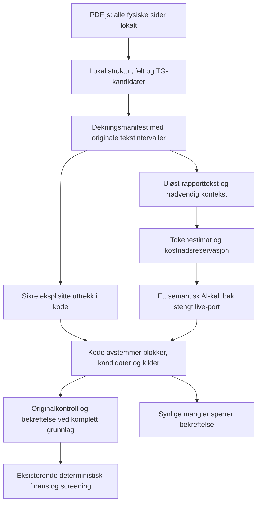

# PAA-SO2: forslag til code-first analyse

Dato: 2026-10-29. **Designforslag, ikke godkjent eller implementert.**
Utgangspunkt: `15402fc307726e0528c1ae0a068b36ab3dee5845` og
[lukket offline-leveranse](../implementation-artifacts/spec-salgsoppgave-offline-build.md).
[Arbeidsplan og godkjenningsport](../implementation-artifacts/spec-salgsoppgave-code-first.md).

## Hva som faktisk finnes

PDF.js leser alle fysiske sider lokalt på backend, i isolert worker/child.
Dette betyr lokal maskin, ikke at PDF-en lastes til OpenAI. Importprofilen
har 200 sider, 50 MiB, 128 KiB tekst per side og 1 MiB samlet tekst.
Overskridelse avviser; den kutter ikke tekst i stillhet. Raster, uleste sider
og vedleggsmetadata beholdes. Originalvisning og kilder med hash, fysisk side,
ordrett sitat og originale tekstoffseter er implementert.

`offline-adapter.ts` bruker derimot syntetiske fixture-hasher og hardkodede
rapportområder, økonomifelter og funn. Ukjent PDF gir `unsupported-synthetic`.
Dette er ikke en generell parser som bare trenger en API-nøkkel.
`combined-request.ts` bygger ekte strict request/digest, men produksjonsteller
mangler. Dagens testteller er uttrykkelig en stub. Importkontrakten tillater
bare `demo` / `offline-synthetic-1`; ny adapter krever versjonert kontekst.

## Anbefaling og alternativer

Behold functional core / imperative shell, én sekvensiell pipeline og
eksisterende Sol/low/Standard. Reduser først mengden modellen må tolke og
skrive. Bruk lokale span-ID-er i stedet for å la modellen gjenta lange
hash-/filnavn-/kildeobjekter og ferdig utfylte økonomifelter.

| Alternativ | Kostnad og vurdering |
| --- | --- |
| Hele salgsoppgaven til AI | Unødvendig tekst, mer persondata og kostnad; ingen garanti for bedre recall. Avvis som standard. |
| Bare sider med TG-nøkkelord | Billig, men kan miste grader, fortsettelser og funn uten søkeord. Oppfyller ikke kravet. |
| Lokal analyse + komplett uløst rapportgrunnlag | Anbefalt. Kode behandler eksplisitte mønstre; AI tolker resten. Dekningshull gir sperre. |
| Bytte direkte til billigste modell | Kan spare ytterligere, men offline-stubber viser ikke TG-kvalitet. Krever egen beslutning og senere kvalitetsprøve. |

Dette er den anbefalte kostnadsreduksjonen innen dagens modellbeslutning,
ikke et bevist globalt minimum blant alle modeller. Ingen live-sammenligning
eller reell salgsoppgaveevaluering er gjennomført i denne økten.

## Lokal behandling

1. Bevar originaltekst, fysisk side og sidestatus for hele dokumentet.
   Søkenormalisering for linjeskift, mellomrom og delte TG-markører har
   offsetkart tilbake til originalen. Trykte sider erstatter aldri fysisk side.
2. Finn rapportoverskrifter, mulige start/sluttområder, innholdsfortegnelse,
   bygningsdeler, identitet, økonomiske etiketter og TG-varianter over alle
   sider. Innholdsfortegnelse alene beviser ikke rapportgrenser. TG-søk er
   kandidatfunn, aldri bevis for at resten mangler TG.
3. Parse entydige beløp, eksplisitt grad, periode og år med små støttede regler.
   Kode kopierer oppgitt TG2/TG3, men innfører ingen nye regler for å gi grad.
   Bevar alternative beløp og alle belegg; ukjent er aldri null kroner.
   Inkludering, eierbetalt andel og gjeldsdel bestemmes bare ved entydig belegg.
4. Del tekst i sammenhengende blokker med originale intervaller. Blokk-ID
   binder hash, fysisk side og offset. Kontinuitet over sidegrenser beholdes.
   Fjern bare eksakt identifisert støy som blanktekst og verifisert gjentatt
   topp-/bunntekst; aldri vilkårlige linjer eller generiske «irrelevante» avsnitt.

Strukturdeteksjonen skal være konservativ. Ukjent layout, flere rapporter,
uforklart TG-funn utenfor valgt område eller uklar slutt gir usikker dekning.
Hvis nødvendig område ikke kan fastslås, behold lokal økonomi/partielle funn,
men krev et komplett tekstbasert rapportgrunnlag før teknisk bekreftelse.
Ingen automatisk eskalering til hele 200-sidersdokumentet. Hvis hele dokumentet
faktisk er tilstandsrapporten, er hele rapportteksten relevant; begrunnelsen og
kostnaden vises. Dette er fortsatt tekst, aldri rå PDF til modellen.

## Hva AI faktisk må gjøre

AI tolker fritekst og relasjoner: hvilken grad gjelder hvilket forhold og
hvilken bygningsdel, fortsettelser/kryssreferanser, sammenfatning kontra
originalfunn, semantiske duplikater og tvetydige økonomiske relasjoner.
Modellen kan foreslå rapportgrenser fra sendt kontekst, men får ikke avgjøre
at usendte sider er gjennomgått eller at usikker dekning er komplett.

Requesten inneholder alle uløste rapportblokker, uløste økonomiblokker og
nødvendige naboblokker/identitet. Ved usikker deterministisk forståelse sendes
hele den berørte blokken. I ukjente rapportformater kan dette bety hele
rapportteksten; lav pris må ikke oppnås ved å miste semantisk grunnlag.
Sikre kodeuttrekk trenger bare nødvendig koblingskontekst. Hver tekst sendes
én gang med stabile referanser; ingen embedding, vector database, webverktøy,
filopplasting, vision eller agentrammeverk trengs.

Strict output returnerer funnforslag, kildespenn, behandlet blokk-ID og
disposisjon for hver TG-kandidat: funn, dokumentert duplikat, begrunnet
ikke-funn eller uavklart. Kode materialiserer eksisterende PdfSource/funn og
validerer ordrett tekst. Uklar sammenslåing forblir uavklart; like beskrivelser
på to bad er ikke automatisk samme forhold. AI beregner ikke finans, foreslår
ikke screening og fyller ikke inn manglende leie, drift eller reparasjonspris.

## Hvordan filtrering ikke skal miste TG2/TG3

Manifestet eies av kode. For hver rapportside må unionen av behandlede
originalintervaller dekke hele den relevante teksten uten hull. Hvert intervall
har regelversjon og lokalt resultat eller kobling til faktisk sendt og
validert AI-blokk. En tom modelliste eller selvrapportert «ferdig» er utilstrekkelig.

Alle TG-kandidater fra hele originalen må avstemmes mot funn, sporbare
duplikater, begrunnet avvisning eller uavklart status. Oppgitt TG2/TG3 kan ikke
avvises som ikke-funn uten kildebelegg; slik motstrid gir sperre. Resttekst
uten søkeord skal fortsatt behandles semantisk. Avvisning av en kandidat må
ikke fjerne resten av blokken. Uventet unik TG-kilde utenfor rapportområdet
krever avstemming eller utvidet område, ikke usynlig sletting.

Manglende blokk/kandidat, ufullstendig modelloutput, ukjent struktur, usikre
grader/tabellkoblinger, raster i rapporten, ubehandlede vedlegg, feil kilde,
identitetsmotstrid eller budsjettbrudd gir `incomplete`/`blocked` med fysisk
restoversikt. Eksisterende sperre for dekning kan ikke bekreftes bort.
Økonomi kan fortsatt brukes etter egen menneskelig kontroll.

Dette kan bevise **ingen ubehandlet tekst utelatt av filtreringen**, ikke
100 prosent semantisk recall i vilkårlige dokumenter. Et tekstlag kan også
ha dårlig rekkefølge eller mangle grafisk informasjon. Ingen regex, modell
eller manifest kan love universell TG-fullstendighet. Ustøttet/grafisk grad
og usikker layout må derfor sperres, ikke få grønn status. Menneskelig
originalkontroll og senere uavhengig live-fasit er fortsatt nødvendige.

## Token- og kostnadskontroll

Foreslått tak: **USD 0,20 per logiske analyse**, delt av salgsoppgave og
eventuell separat rapport. Ingen automatisk ny kvote ved refresh, timeout
eller nytt vedlegg. Maksimalt ett semantisk kall per dokument; alle forsøk
reserveres under samme analysetak. Ingen automatisk retry eller chunking.
En analyse uten semantisk rest koster USD 0 i modellbruk.

Foreslåtte requestgrenser: opptil 40 000 inputtokens og 8 000 outputtokens
inklusive reasoning. Disse er budsjetter, ikke lovnad om at alle 200-siders
rapporter passer. Før transport: tell hele endelige requesten med prompt,
strict schema, tekst, metadata og framing; bind estimat/reservasjon til dens
digest, modell og datert pristabell. Endret request krever ny preflight.

Lokal teller må være modelltilpasset med dokumentert framing/øvre margin.
Ikke merk `JSON.stringify`-telling, `tegn/4` eller injisert testteller som
verifisert. Faktiske inputtokens kan avvike fra et lokalt estimat.
[OpenAI beskriver begrensninger ved lokal telling](https://developers.openai.com/api/docs/guides/token-counting).
Ingen nettbasert tokentelling utføres her. Dersom lokal teller/framing ikke
kan verifiseres offline, leveres estimat tydelig som uverifisert og live forblir
blokkert; ingen falsk grønn preflight for å oppfylle tidsplanen.

Standardpris kontrollert 2026-10-29: Sol USD 2/M input og USD 10/M output;
[offisiell modellside](https://developers.openai.com/api/docs/models/gpt-6.1-sol).
Reasoning inngår i output og `max_output_tokens`, jf.
[reasoning-dokumentasjonen](https://developers.openai.com/api/docs/guides/reasoning).
Ingen cachetreff eller rabatter forutsettes. Pristabellen må også håndtere
eventuelle cache-write-/regiontillegg før live; ukjent pris sperrer.

| Regneeksempel, ikke målt dokumentforbruk | Input | Output inkl. reasoning | Standardpris |
| --- | ---: | ---: | ---: |
| Kort semantisk rest | 10 000 | 2 000 | USD 0,040 |
| Større rapportgrunnlag | 20 000 | 4 000 | USD 0,080 |
| Foreslåtte requestmaksima | 40 000 | 8 000 | USD 0,160 |
| Dagens kombinert-maksima | 100 000 | 16 000 | USD 0,360 |

Arbeidsforventning er **USD 0,04–0,08 for eksempeldokumenter med dette
tokenvolumet**, ikke et målt gjennomsnitt eller en pris bestemt av sidetallet.
Faktisk forhåndsestimat vises for hver PDF. En konservativ reservasjon med
USD 2,50/M input og 10 prosent tillegg ved requestmaksima er USD 0,198;
USD 0,20-taket gir dermed rom for dette priseksemplet. Bruk gjeldende
verifiserte makssatser, ikke en blind fast margin. Outputkapasitet må prøves
mot mange funn; avkorting gir sperre, aldri bortfall av siste funn.

[Pristabellen](https://developers.openai.com/api/docs/pricing) oppgir også
Terra USD 1/5 og Luna USD 0,10/0,50 per million input/output. Ved 20k/4k
blir det henholdsvis USD 0,040 og USD 0,004. Dette er prissammenligning,
ikke bevis for lik TG-kvalitet, kontotilgang eller anbefaling om modellbytte.
Bevar R1-modellen i første leveranse. Vurder en billigere modell først etter
egen godkjenning og sammenligning mot samme uavhengige TG-fasit før rettinger.

Reservasjon skjer før SDK-kallet. Registrer faktisk usage og kostnad etter
svar; ved timeout/ukjent belastning behold reservasjonen. Dobbeltklikk,
gjenbruk og samme hash/request må ikke belastes på nytt. Serverrestart må
ikke tolkes som null historisk forbruk ved senere live-preflight. Ingen
ny konto-/prosjektbudsjettfullmakt utledes av denne designgodkjenningen.

## Implementering og offline-bevis etter godkjenning

Gjenbruk PDF-isolasjon, shared lock, await-close og kilde-/TG-validering.
Skill generisk lokal plan fra det bevarte syntetiske demoregisteret. Ny
importkontekst må binde faktisk modell/modus, plan-/promptversjon og digest;
legacy 30-siderskontrakt og FINN forblir uendret. Transporten gjenbruker
SDK-/abortmønsteret og bounded fetch fra listing-backend, med 120 s absolutt
live-frist etter den lokale 60 s-fasen, uten å utvide lokal PDF-frist.
Produksjonsruten forblir stengt selv med eksisterende `ANALYSIS_MODE=live`.

Uavhengig fasit skrives før stubbesvar. Nye fixturer dekker TG uten eksplisitt
søkeord i blokken, delt TG-markør, tabeller, sidefortsettelse, siste side,
oppsummering kontra original, to like bad, TG utenfor valgt rapport,
feil identitet, ukjent rapportgrense og raster. Negative adapterprøver fjerner
én blokk/én kandidat og endrer offset/hash/side: alle skal sperres. Budsjett
prøves under/på/over grense, manglende teller/pris, endret digest, timeout,
gjenopplasting og separat rapport med brukt delbudsjett. Store funnlister og
ufullstendig output kan aldri gi grønn tomliste.

Kjør målrettede tester, full unit/integrasjon, build/lint og berørte
nettleserflyter med tom nøkkel/stubbet transport. Bevar eksisterende
finans-/screeningfasit og kontroller diff for regelendringer. Gjennomfør
uavhengig BMAD-review, dokumenter konkrete utfall og commit lokalt med
aktiv promptlogg. Stopp før første live-test. Offline-bevis er bevis for
kode/feilhåndtering, ikke for modellens reelle TG-recall.

Kursforankring: sensorveiledningen side 2–6 og faglærerens
[tilbakemelding](briefs/brief-IBE160-2026-09-15/tilbakemelding-product-brief.md)
underbygger sporbarhet, vanlig kode for finans, enkel pipeline, fasit og
offline demo. De pålegger ikke ny prisgrense, modell, lagring eller TG-regel.
