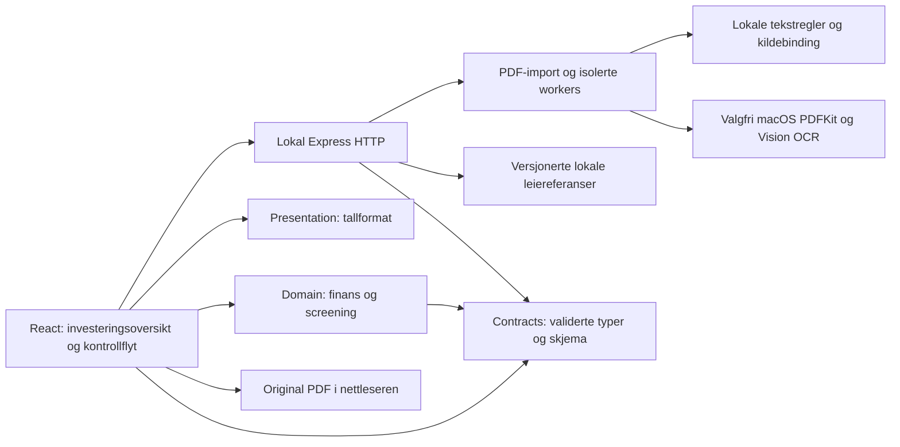

# Gjeldende leveranse, arkitektur og kravspor

Dato: 2026-11-06. Produktreferanse: `639291814886a6058a24adf95c69e8633b645944`.
Dette er en avstemming av eksisterende beslutninger og faktisk kode, ikke en ny produktbestilling eller en etterfølgende omskriving av opprinnelige krav. Leveransekontrollen endrer ingen produktkode.

## Hvilket omfang leveres?

[Revidert Brief](../../planning-artifacts/briefs/brief-IBE160-2026-09-15/brief.md) og [PRD 10. oktober](../../planning-artifacts/prds/prd-IBE160-2026-10-10/prd.md) avgrenset v1 etter [faglærerfeedback](../../planning-artifacts/briefs/brief-IBE160-2026-09-15/tilbakemelding-product-brief.md). Kjerneverdien består: kontrollerbare originalkilder, finans i kode og menneskets beslutning. Flere opprinnelige ikke-mål er senere uttrykkelig bestilt. Det betyr ikke at de alltid var del av godkjent v1, eller at alle opprinnelige suksessmål nå er oppfylt.

| Beslutning og begrunnelse | Faktisk leveranse og spor | Grense |
| --- | --- | --- |
| 6.–10. oktober: smal førstevurdering fremfor sju autonome produktagenter, score og full due diligence | [Brief-revisjon](../../planning-artifacts/briefs/brief-IBE160-2026-09-15/revisjonskontroll-2026-10-08.md), [PRD-beslutninger](../../planning-artifacts/prds/prd-IBE160-2026-10-10/beslutningsavstemming.md), [opprinnelig kravspor](../../specs/spec-IBE160/sporbarhet.md). Tall, TG-kontroll og faste anbefalinger. | Ingen budsending, kjøpsbeslutning, brukerkonto eller varig portefølje. Subagenter i utviklingen er ikke produktagenter i appen. |
| 28. oktober: salgsoppgave først, fordi investoren trenger ett dokumentbasert grunnlag | [Godkjent D1–D3/endringsforslag](../../planning-artifacts/sprint-change-proposal-2026-10-28.md), [offline-spec](../../implementation-artifacts/spec-salgsoppgave-offline-build.md). Ny hovedimport 200 sider / 50 MiB. | Den gamle separate rapportadapterens 30-sidersgrense består. Automatisk behandling av alle vedlegg er ikke levert; rapport som vedlegg krever separat opplasting. FINN-felt er fjernet fra brukerflaten; bevarte ruter har stengt tilgangsport. |
| 29.–31. oktober: generell lokal analyse fremfor dyr eller upålitelig generell modellforståelse | [Code-first design](../../planning-artifacts/salgsoppgave-code-first-design-2026-10-29.md), [implementasjon](../../implementation-artifacts/spec-salgsoppgave-code-first.md), [økonomiprøvens resultat](../../implementation-artifacts/salgsoppgave-economy-trial-2026-10-30/compact-resultat.md). Eksplisitte beløp og kildeintervaller; lokale risikoregler. | Generell semantisk import er deaktivert. Økonomi-KI har separat historikk/port; den gjør ikke uleste tekniske sider komplette. |
| 30. oktober: godkjent Konsept A for å gjøre førstevurderingen lettere å lese | [DESIGN](../../planning-artifacts/ux-designs/ux-IBE160-2026-10-30/DESIGN.md), [EXPERIENCE](../../planning-artifacts/ux-designs/ux-IBE160-2026-10-30/EXPERIENCE.md), [verifikasjon](../../implementation-artifacts/konsept-a-verifikasjon.md). Lys investeringsoversikt med fordypning og bevart kontrollflyt. | Historisk grafitt/petrol og fire trinn beskriver den bevarte kontrollreisen, ikke dagens første skjerm. |
| 31. oktober–4. november: lokale juridiske/tekniske indikasjoner og valgfri grafisk avlesning med synlige mangler | [Eiendomsrisiko](../../implementation-artifacts/spec-eiendomsrisiko-og-dokumentanalyse.md), [tekst](../../implementation-artifacts/spec-teknisk-dokumentanalyse.md), [grafisk TG](../../implementation-artifacts/spec-grafisk-tg-analyse.md), [fortsettelser](../../implementation-artifacts/spec-tg-fortsettelser.md). | Ingen kontroll av lovlig utleie, grunnbok eller kommunalt arkiv. OCR er macOS-avhengig og gir aldri automatisk komplett teknisk dekning. Forberedte tolkningsområder er ingen utført KI-analyse. |
| 4.–5. november: lokalt, datert leiegrunnlag fremfor live-oppslag og udokumentert individuell leie | [Lokale kilder/metode](../../implementation-artifacts/leieagent-lokale-referanser.md), [spec](../../implementation-artifacts/spec-lokalt-leiegrunnlag.md). Hybel/Menon, Utleiemegleren/NTB og separat SSB 2025-snapshot. | Gruppesnitt er ikke individuell markedsleie. Ingen prisvekst-, utsikts- eller standardjustering. Statistikkår beholdes; ingen ny datering ved beregning. |
| 5.–6. november: samlet kapitalbehov, annuitet og redigerbart scenario med tydelige standarder | [Investeringsverktøy](../../implementation-artifacts/spec-paa-investeringsverktoy.md), [forhåndsutfylling](../../implementation-artifacts/spec-forhandsutfylt-okonomiscenario.md), [beslutning/QA](../arbeidsokter/2026-11-06-okonomistandarder.md). | Autorisert utvidelse av opprinnelige ikke-mål. Scenario erstatter ingen brukerbekreftelse eller kontrollert anbefaling. Standarder 80 % / 6 % / 360 måneder er antakelser. Dokumentert driftsdelsum er foreløpig; ukjente poster forblir ukjente. |

## Gjeldende arkitektur

[Arkitekturens AD-1–AD-10](../../planning-artifacts/architecture/architecture-IBE160-2026-10-14/ARCHITECTURE-SPINE.md) dokumenterer den opprinnelige beslutningen og begrunnelsene. Modulgrensene gjelder fortsatt, mens importprofil, UI og lokale hjelpere er utvidet gjennom kildene over.

- [server.ts](../../../src/backend/server.ts) binder til `127.0.0.1`, serverer bare `dist/` i bygget modus og monterer API-er. Utvikling bruker Vite-middleware i samme prosess. Ingen database, sky eller innlogging trengs.
- [domain](../../../src/domain/README.md) har ren, testbar finans-/kontrolllogikk. Big.js gir desimalregning og uavrundede terskler. [presentation](../../../src/presentation/README.md) formaterer; visningsverdier blir ikke nye regelinput.
- [Økttilstand](../../../src/frontend/state/session.ts) og scenario holdes separat. Kontrollert resultat binder revisjoner; endringer gjør gammelt resultat historisk. Egen scenariojustering bekrefter ingen rapport eller tall.
- [PDF-import](../../../src/backend/http/import-route.ts) og [import-runtime](../../../src/backend/http/import-runtime.ts) eier opplasting, prosesslåser, tids-/byte-/minnevern og opprydding. Fysisk side og originalhash følger kildene. Parser- og OCR-vern er separate, ikke et samlet minnebudsjett for hele prosesstreet.
- [Lokale leiedata](../../../src/backend/rent/data/) følger med klonen. Originalkildelenker er til videre lesing, ikke nødvendige runtime-oppslag.
- Den bevarte FINN-/live-/preflight-koden er isolert og har historisk spor/testverdi. Stor opprydding eller ny arkitektur er ikke begrunnet i leveransens avslutning; det ville skape regresjonsrisiko uten å styrke kjernebeviset.

### Presis KI-, kostnads- og lagringsstatus

| Vei | Gjeldende status | Hva sensor kan slutte |
| --- | --- | --- |
| Vanlig `/api/document-import` | Lokale regler; config gir `liveEnabled:false`. [semantic-adapter](../../../src/backend/import/semantic-adapter.ts) tillater bare transport merket `offline-stub`, ikke betalt generisk transport. | Ingen generell semantisk forståelse eller modellbasert TG-kompletthet i hovedimporten. Lokale funn kan kontrolleres mot original. |
| Lokal OCR | PDFKit/Vision på støttet macOS, ingen språkmodelltjeneste | Bilder kan gi kildebelagt lokal gradtolkning. Utydelig/ulest materiale forblir uavklart. |
| Historisk demo for F1–F4 | Rapportbundne fiktive demosvar; [opphav](../../../src/backend/analysis/data/README.md) sier de er skrevet for demoen | Beviser kontrollflyt og regler; er ikke et faktisk modellresultat. UI-ordet «KI-uttrekk» skal leses med denne opphavsavgrensningen. |
| Eldre separat rapport-live | [backend-config](../../../src/backend/analysis/backend-config.ts) støtter eksplisitt `ANALYSIS_MODE=live` og lokal nøkkel | Bevart kode og datert evaluering, ikke aktivert i den nøkkelfrie sensoroppskriften. Ingen nye live-kall utført i denne kontrollen. |
| Separat dokumentøkonomi-KI | [economy-route](../../../src/backend/http/economy-route.ts) er montert også i demo. Eksplisitt kostnads-/overføringssamtykke, nøkkel og budsjettkontroll kreves. | `ANALYSIS_MODE=demo` er ikke en global betalt-rute-sperre. Standardoppskriften uten nøkkel åpner ingen slik betalt prøve. Historiske økonomisvar er ikke bevis for full teknisk analyse. |
| Data i standard hovedflyt | Original og vurdering ligger midlertidig i frontend; importens serverfiler ryddes etter request | Sideoppdatering avslutter vurderingen; appen er ikke et arkiv. |
| Valgfrie økonomihjelpere | Forberedte pakker/outcome har 15 minutters gyldighet, men kan bli liggende i serverminnet til neste forberedelsesrequest, utskifting eller serverstopp; godkjente live-hjelpere kan lagre private resultater/budsjettjournaler | Påstanden «ingen data lagres noe sted» ville være feil. `private/` er ignorert og ikke del av statisk server eller sensors datagrunnlag. |

## PRD til implementasjon og tester

ID-ene og kravfasiten beholdes. «Realisert» nedenfor gjelder angitt kontrollomfang; det er ikke et krav om at vilkårlige PDF-er får komplett analyse. Alle teststier kan kjøres etter README. Ferske antall og skip står i [teknisk rapport](teknisk-og-test.md) og [ren klon](ren-klon.md).

| Krav | Faktisk ansvar | Etterprøvbart testspor | Status/avvik |
| --- | --- | --- | --- |
| FR-1: P/L/D/J/Ymin | `domain/financial-basis.ts`, `FinancialInput.tsx` | [financial-basis](../../../tests/unit/financial-basis.test.ts), [financial-input E2E](../../../tests/e2e/financial-input.spec.ts) | Kontrollert input består; senere PDF-kandidater og scenario er ubekreftede. |
| FR-2: kilder/kostnadsinnhold | `domain/common-cost-content.ts`, `financial-basis.ts` | [kostnads-/kildegrunnlag](../../../tests/unit/financial-basis.test.ts), [document-import](../../../tests/integration/document-import.test.ts) | Inkluderte delposter og renter/avdrag skilles; automatisk delsum er ikke full eierdrift. |
| FR-3: blank/0/ugyldig | `domain/validation.ts`, `financial-validation`-kontrakt | [finansiell validering](../../../tests/unit/financial-validation.test.ts) | Blank blir ikke 0; eksplisitt nullkontroll kreves i kontrollflyten. |
| FR-4: bekreft tall | `FinancialInput.tsx`, økttilstand | [financial-confirmation](../../../tests/unit/financial-confirmation.test.ts) | Registrering/scenario er ikke bekreftelse. |
| FR-5: separat TG3-avklaring | `domain/tg3-resolution.ts` | [tg3-resolution](../../../tests/unit/tg3-resolution.test.ts), [screening E2E](../../../tests/e2e/screening-result.spec.ts) | Avklart krever begrunnelse og konkret grunnlag; systemet verifiserer ikke brukerens eksterne opplysninger. |
| FR-6: én rapport, demo/live | `analysis/`, `documents/`, ny importprofil | [demo-analysis](../../../tests/integration/demo-analysis.test.ts), [pdf-format](../../../tests/integration/pdf-format.test.ts), [prospectus E2E](../../../tests/e2e/prospectus-import.spec.ts) | Endret hovedinngang/sidegrense etter D1–D3; gammel 30-siders adapter består. |
| FR-7: alle eksplisitte TG2/TG3 | `import/technical-risk.ts`, `technical-interpretation.ts` | [technical-risk](../../../tests/unit/technical-risk.test.ts), [historisk S2](../../implementation-artifacts/story-4-4-b2-uavhengig-sluttreview-2026-10-27.md) | Bare historisk kontrollerte livecaser oppfyller det målte S2-grunnlaget. Dagens lokale analyse gir delvis dekning; generell fullstendighet er **ikke bevist**. |
| FR-8: original/kilde/side | PDF-kontrakter, `frontend/pdf/` | [pdf-source](../../../tests/unit/pdf-source.test.ts), [prospectus E2E](../../../tests/e2e/prospectus-import.spec.ts) | Fysisk PDF-posisjon er autoritativ; trykt nummer og flere belegg beholdes. |
| FR-9: feil/usikkerhet | Importkontrakt, dekningsstatus, rapportkontroll | [document-analysis](../../../tests/unit/document-analysis.test.ts), [import-input](../../../tests/integration/import-input.test.ts) | Ingen feil→vellykket tomliste; ukjent/ulest teknisk grunnlag blokkerer. |
| FR-10: korriger/avvis | `domain/finding-control.ts` | [finding-control](../../../tests/unit/finding-control.test.ts), [report-analysis E2E](../../../tests/e2e/report-analysis.spec.ts) | Originalt opphav bevares; ny modellkjøring trengs ikke. |
| FR-11: bekreft gjeldende liste | `FindingListControl.tsx`, økttilstand | [finding-list-control](../../../tests/unit/finding-list-control.test.ts) | Listebekreftelse er separat fra TG3 og komplett dokumentdekning. |
| FR-12: fire finansformler | `domain/finance.ts` | [finance](../../../tests/unit/finance.test.ts), [finansfasit](../../../tests/fixtures/property-cases/expected.json) | Uendret P/L/D/J-definisjon; nye annuitets-/kapitalmoduler er egne utvidelser. |
| FR-13: gyldige delberegninger | `domain/finance.ts`, `screening.ts` | [complete-screening](../../../tests/unit/complete-screening.test.ts), [screening](../../../tests/unit/screening.test.ts) | Mangler har prioritet over økonomisk pass/fail. |
| FR-14: presisjon og etterprøving | `domain/thresholds.ts`, `presentation/finance.ts` | [thresholds](../../../tests/unit/thresholds.test.ts), [financial-presentation](../../../tests/unit/financial-presentation.test.ts) | Regler bruker uavrundede verdier; visning kan ikke vippe terskelen. |
| FR-15: nytt grunnlag/ingen unødige kall | `state/result.ts`, finans-/rapportrevisjoner | [financial-result-renewal](../../../tests/unit/financial-result-renewal.test.ts), [result-snapshot](../../../tests/unit/result-snapshot.test.ts) | Gammelt resultat merkes utdatert; scenario og kontroll holdes atskilt. |
| FR-16: tre anbefalinger | `domain/screening.ts` | [demo-screening](../../../tests/integration/demo-screening.test.ts), [prospectus E2E](../../../tests/e2e/prospectus-import.spec.ts) | Alle tre er demonstrerbare med fiktive data og nødvendig kontroll. |
| FR-17: regelbegrunnelse/neste handling | `domain/screening.ts`, `ScreeningResult.tsx` | [screening](../../../tests/unit/screening.test.ts), [resultatkomponent](../../../tests/components/screening-result.spec.ts) | Kodebestemt; ingen språkmodell skriver anbefalingen. |
| FR-18: samlet, revisjonsbundet resultat | `state/result.ts`, resultatvisning | [result-snapshot](../../../tests/unit/result-snapshot.test.ts), [investment-overview E2E](../../../tests/e2e/investment-overview.spec.ts) | Scenariet kan endres uten å skrive om kontrollert snapshot. |
| NFR-1: robusthet | Prosesslåser, revisjoner, barn/workers | [http-pipeline-races](../../../tests/unit/http-pipeline-races.test.ts), [import-worker-heap](../../../tests/integration/import-worker-heap.test.ts) | Feil/gjentakelse/ressursgrenser prøvd; ikke formell oppetids- eller belastningsgaranti. |
| NFR-2: UX/tilgjengelighet | Konsept A, PDF-dialoger, skjema/grafer | [investment-overview](../../../tests/e2e/investment-overview.spec.ts), [finansieringskomponent](../../../tests/components/scenario-financing.spec.ts) | Tastatur, fokus, responsive visninger og feil er prøvd. Ingen full hjelpemiddel-/WCAG-revisjon hevdes. |
| NFR-3: lokal kjørbarhet | Én server, lokale assets/data | [server-mode](../../../tests/integration/server-mode.test.ts), [ren klon](ren-klon.md) | Nøkkelfri og uten private filer; macOS er prøvd, øvrige OS ikke. |
| NFR-4: nøkler/personvern | Backendkonfigurasjon, gitignore, statisk rot | [backend-config](../../../tests/unit/backend-config.test.ts), [historikkskann](repository-audit.json) | Mønsterskann er støtte, ingen garanti mot alle hemmelighetstyper. |
| NFR-5: tid/kontrollmål | Historisk måleprotokoll | [S5-waiver](../../implementation-artifacts/story-4-5-s5-waiver-2026-10-27.md) | Ikke fullt verifisert; formell akseptanse er ufullstendig. |

### Suksessmål S1–S6 og uunderbygde påstander

| Mål | Hva bevisene støtter | Hva som ikke kan hevdes |
| --- | --- | --- |
| S1 beregninger | Forhåndsdefinerte F1–F4/regelvarianter og nye scenario-/annuitetsfasiter; eksakte grense- og dobbeltellingstester | Finansfaglig godkjenning av alle reelle investeringsforutsetninger eller full årsdrift fra enhver PDF. |
| S2 dokumentfunn | Historiske originale F1/F2-livebevis og avgrenset syntetisk fasit, klart atskilt fra lokal import | Generell TG2/TG3-presisjon, full recall eller komplett analyse av de private 152/170-siders originalene. |
| S3 regler/mangler | Deterministisk prioritet, terskler, TG3, feil, blank/null og revisjoner har kjørte tester | At få lokale treff gjør ukjent/ulest dokumentgrunnlag komplett. |
| S4 sporbarhet | Hash, kildeintervall, fysisk side, originalvisning og opphav prøves i kontrakt/PDF/UI | At en gyldig kilde automatisk beviser riktig semantisk tolkning eller juridisk sannhet. |
| S5 tidsbruk | Datert protokoll, feilrapportering og brukerens uttrykkelige aksept av S5-W1 | Bestått formell S5-akseptanse eller validert tidsbesparelse mot manuelt arbeid. |
| S6 annen person | AI-assistert ren-klon-/README-prøve dokumentert separat | At en annen person har fullført demo/test uten hjelp. S6 er fortsatt åpen. |

S5-W1, S6, generell dokument-/TG-dekning og individuell leiekalibrering følges bare i [sentral oversikt](../../implementation-artifacts/deferred-work.md). Denne tabellen er avstemming av bevis, ingen parallell oppgaveliste. En «done»-spec beviser implementasjon innen sitt omfang, ikke generell dokumentkvalitet eller menneskelig godkjenning.
